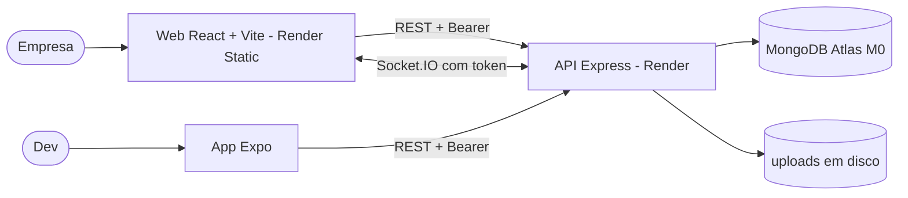
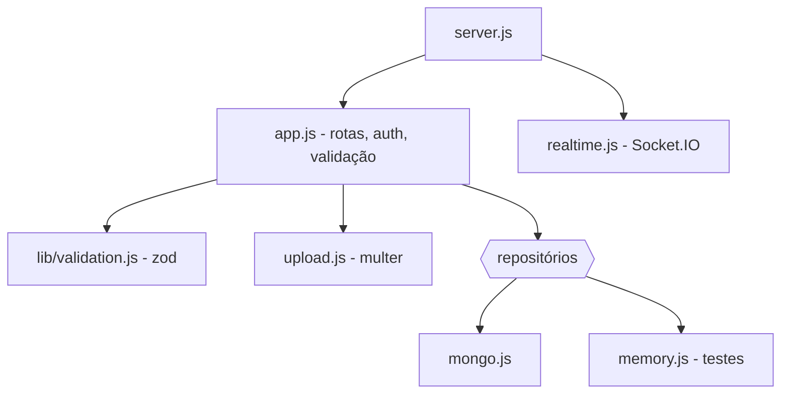

# Como documentar a arquitetura (C4 em Mermaid)

A arquitetura de cada repositório fica em `docs/ARQUITETURA.md`. O modelo C4 tem quatro níveis; no portfólio usamos só os dois primeiros, que cabem num arquivo e o GitHub desenha sozinho com Mermaid.

## Estrutura do `docs/ARQUITETURA.md`

1. **C4** — nível 1 (contexto e contêineres) e nível 2 (componentes da API ou do app principal).
2. **Contrato da API** — tabela com método, rota, autenticação e resposta.
3. **Modelo de dados** — coleções ou tabelas, campos e índices.
4. **ADRs** — tabela curta das decisões, ou link para `docs/adr/` (ver [`modelo-adr.md`](modelo-adr.md)).

Regras:
- Escrever o que o código faz hoje. Se uma ADR não foi cumprida no código, registrar como risco.
- Nomes dos blocos com a tecnologia e a hospedagem (`API Express 5 - Render`).
- Cada seta diz o protocolo (`REST + Bearer`, `Socket.IO`).
- Atualizar no mesmo PR que muda a arquitetura.

## Nível 1: contexto e contêineres

Pessoas, apps, API e armazenamento. Exemplo resumido do `aircnc`:

## Nível 2: componentes

As partes internas do contêiner principal e quem depende de quem.

## Contrato da API (formato)

| Método | Rota | Auth | Resposta |
|---|---|---|---|
| POST | /sessions | — | `{ user, token }` |
| GET | /spots?tech= | — | lista pública |
| POST | /spots | Bearer | 201 com o recurso |
| POST | /bookings/:id/approvals | Bearer (dono) | recurso; 403 ou 409 |

Eventos de tempo real também entram: nome do evento, quem recebe, o que exige.

## Modelo de dados (formato)

| Coleção | Campos | Índices |
|---|---|---|
| users | email | único |
| bookings | date (AAAA-MM-DD), approved, user, spot | único (user, spot, date) |

## Projeto sem API

Site estático ou SPA sem servidor: um diagrama só, com o navegador, o build e a hospedagem, e as APIs externas que ele chama.
