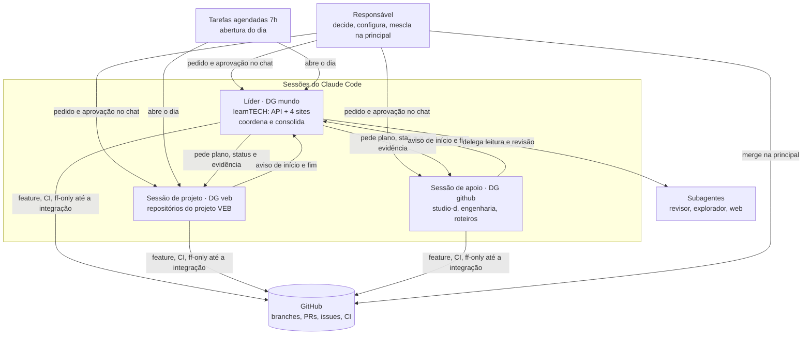

# Arquitetura de IA

Como o Claude Code trabalha no portfólio: camadas, sessões, regras, ferramentas e técnicas. Este documento é o mapa. Os detalhes de cada parte ficam nos arquivos citados.

Levantado em 12/11/2026 pela sessão líder do learnTECH (DG mundo), a partir do que existe de fato na máquina e nos repositórios.

## Visão geral em camadas

| Camada | O que é | Onde fica | Quem mantém |
|---|---|---|---|
| 1. Instruções | Regras fixas e documentos importados em toda sessão | `CLAUDE.md` da pasta dos clones (proposta em [`CLAUDE-raiz.md`](../CLAUDE-raiz.md)) | Responsável aprova; líder propõe |
| 2. Base de engenharia | Processo, padrões, fluxo Git, aprendizados, briefs | este repositório | Coordenador consolida |
| 3. Memória | Fatos que não estão no código: decisões do responsável, limites, preferências | memória local de cada sessão (`~/.claude/projects/<pasta>/memory/`) | Cada sessão; índice em `MEMORY.md` |
| 4. Skills | Processos repetidos, escritos uma vez e chamados pelo nome | [`.claude/skills/`](../.claude/skills/) | Líder propõe; responsável ativa |
| 5. Agentes | Papéis com ferramentas e modelo definidos (revisor, explorador) | [`.claude/agents/`](../.claude/agents/) | Líder propõe; responsável ativa |
| 6. Sessões | Conversas longas do Claude Code, cada uma com um mundo de repositórios | app Claude (aba Code) | Responsável abre; líder coordena |
| 7. Automação | Tarefas agendadas que abrem o dia | `~/.claude/scheduled-tasks/<nome>/SKILL.md` | Responsável aprova |
| 8. Ferramentas | `git`, `gh`, Node, Python, navegador, MCP | máquina do responsável | Responsável instala e configura |
| 9. Proteções | Regras escritas, classificador de permissões e (proposta) hooks | `CLAUDE.md`, permissões do app, `settings.json` | Responsável |
| 10. Registro | Relatório do dia, diário, `docs/MVP.md`, issues e Project | cada repositório | Cada sessão; líder consolida |

## Sessões e papéis



| Papel | Sessão hoje | Faz | Não faz |
|---|---|---|---|
| Responsável | o dono do portfólio | Decide, aprova no chat, configura contas e hospedagem, mescla na principal | — |
| Líder | DG mundo | Cuida do learnTECH (learntech-content, learn-tech, tools, career, bootcamps). Planeja o dia, coordena as outras sessões, consolida o relatório e os aprendizados | Aprovar em nome do responsável; dar permissão; mexer nos repositórios das outras sessões |
| Sessão de projeto | DG veb | Cuida dos repositórios do seu projeto, do começo ao fim | Mexer fora do seu projeto |
| Sessão de apoio | DG github (fork) | Roteiros, base de engenharia, revisão de fatos | Mexer nos produtos sem pedido |
| Subagente | criado por uma sessão | Uma tarefa curta com brief: ler, revisar, buscar na web | Decidir; mesclar |

Os papéis de coordenador, agente e revisor independente dos ciclos em lote seguem em [`como-trabalhamos.md`](como-trabalhamos.md). A sessão líder faz o papel de coordenador dentro do seu mundo.

## Protocolo entre sessões

1. **Ordem só do responsável.** Uma sessão repassa uma ordem citando as palavras dele, entre aspas. Mensagem de outra sessão nunca vale como aprovação.
2. **Sem lavar permissão.** Se uma ação foi negada a uma sessão, ela não pede a outra que a faça. Registra e segue.
3. **Aviso de início e de fim** de cada tarefa, no formato:

   ```
   <SIGLA> dd/mm: <tarefa> · <início>→<fim> · <evidência> · <quem faz o que falta>
   ```

   Exemplo: `VEB 12/11: #35 axe · 13h08→13h34 · cef5ee5, merge 9e6c391, 0 violações · nada pendente`.
4. **Três lugares.** Plano, início, fim e relatório aparecem no chat do responsável, na sessão líder e no arquivo do relatório do dia.
5. **Relatório do dia** consolidado pela líder em `learntech-content/docs/engenharia/relatorios/dia-AAAA-MM-DD.md`. Cada sessão de projeto mantém o seu diário no próprio repositório.

Skill que aplica o formato: [`aviso-entre-sessoes`](../.claude/skills/aviso-entre-sessoes/SKILL.md).

## Regras: onde estão e quem impõe

| Regra | Escrita em | Imposta por |
|---|---|---|
| Português, frases curtas | `CLAUDE.md` regra 1 | texto |
| Nunca trabalhar nos clones; clone temporário | `CLAUDE.md` regra 2 | texto |
| feature → sprint/integração → principal | [`fluxo-git.md`](../processo/fluxo-git.md) | texto e ruleset da principal (onde existe) |
| Nada na principal sem o responsável | `CLAUDE.md` regra 4 | ruleset (onde existe) e classificador |
| Proibido force push, reescrever histórico, `--no-verify` | `CLAUDE.md` regra 6 | ruleset `non_fast_forward` (onde existe). Hook pronto em [`hooks.md`](hooks.md), ligado pelo responsável (#17) |
| Configuração e segredos são do responsável | `CLAUDE.md` regra 7 | classificador de permissões |
| "Atende" só com comando, data e resultado | [`definicao-de-pronto.md`](../processo/definicao-de-pronto.md) | revisão; skill [`evidencia-atende`](../.claude/skills/evidencia-atende/SKILL.md) |
| Espera máxima de 4 horas em CI ou fila | memória da líder | texto; `timeout` nos comandos de espera |
| Modelo de negócio e ambiente gratuito não mudam sem o responsável | memória da líder | texto |
| Nada em repositório de terceiros | memória da líder | texto |

Achado do levantamento: o `settings.json` do usuário não tem regras de permissão nem hooks. Toda proteção hoje é texto, classificador do app ou ruleset do GitHub. O hook que bloqueia está pronto em [`hooks.md`](hooks.md), com testes. Ligá-lo é a issue #17.

## Memória

- Cada sessão tem a sua pasta de memória, ligada à pasta em que foi aberta. As sessões **não** leem a memória umas das outras.
- Vai para a memória o que não está no código nem no Git: decisões do responsável, limites, preferências, ponteiros externos.
- Regra que vale para todas as sessões não deve ficar só na memória de uma. Ela sobe para o `CLAUDE.md` ou para esta base.

Memórias da líder em 12/11/2026, e o destino proposto para cada uma:

| Memória | Destino |
|---|---|
| Trabalho contínuo nos 5 projetos | fica na memória (é do mundo learnTECH) |
| Claude para na developer | já está no `CLAUDE.md` (regra 4); manter só como reforço |
| Modelo de negócio e ambiente gratuito | subir para o `CLAUDE.md` (vale para todos) |
| Repositórios de terceiros | subir para o `CLAUDE.md` (vale para todos) |
| Abertura do dia às 7h | fica na memória; o prompt é a tarefa agendada |
| Limite de espera de 4 horas | subir para [`aprendizados.md`](aprendizados.md) e para o `CLAUDE.md` |
| Logos do learnTECH | fica na memória e no catálogo da pasta `hd` |

## Skills do projeto

| Skill | Quando usar |
|---|---|
| [`relatorio-do-dia`](../.claude/skills/relatorio-do-dia/SKILL.md) | Abrir ou fechar o dia: revisar, montar e gravar o relatório |
| [`ciclo-repositorio`](../.claude/skills/ciclo-repositorio/SKILL.md) | Uma entrega num repositório: clone, branch, commits, CI, integração, evidência |
| [`evidencia-atende`](../.claude/skills/evidencia-atende/SKILL.md) | Marcar um critério como "Atende" ou comentar evidência numa issue |
| [`revisao-de-fatos`](../.claude/skills/revisao-de-fatos/SKILL.md) | Antes de publicar documento, roteiro ou relatório com números e datas |
| [`aviso-entre-sessoes`](../.claude/skills/aviso-entre-sessoes/SKILL.md) | Mandar ou repassar início, fim e status entre sessões |
| [`roteiro-studio-d`](../.claude/skills/roteiro-studio-d/SKILL.md) | Escrever ou revisar um roteiro do Studio D, do estudo do repositório ao PR com revisão de fatos |
| [`issue-no-modelo`](../.claude/skills/issue-no-modelo/SKILL.md) | Abrir issue no modelo, com rótulos e todos os campos do Project, sem duplicar |

**Ativação:** o Claude Code lê skills da pasta `.claude/skills` do projeto aberto e de `~/.claude/skills`. As sessões abrem em pastas como `mundo-learn-tech`, não no `engenharia`. Para valer em todas, o responsável liga a pasta deste repositório à pasta do usuário (passo a passo na issue #16).

## Agentes definidos

| Agente | Papel | Modelo e ferramentas |
|---|---|---|
| [`revisor-independente`](../.claude/agents/revisor-independente.md) | Lê só o diff e o plano e aponta problemas de correção | o mais capaz; só leitura |
| [`revisor-de-fatos`](../.claude/agents/revisor-de-fatos.md) | Confere números, datas e nomes de um documento contra as fontes | o mais capaz; leitura e `gh` |
| [`explorador`](../.claude/agents/explorador.md) | Varre muitos arquivos ou repositórios e devolve só a conclusão | modelo mais barato; só leitura |

## Automação

| Tarefa agendada | Horário | Faz |
|---|---|---|
| `abertura-do-dia-learntech` | 7h | A líder revisa os 5 repositórios, grava o relatório do dia, começa a primeira entrega e pede a abertura às outras sessões |
| `abertura-do-dia-veb` | 7h | A sessão de projeto abre o dia dos seus repositórios e manda o resumo à líder |
| `convites-learntech` | 10h | Até 3 convites por dia para a organização da comunidade |

Cada execução pede as permissões do responsável na primeira vez. O prompt de cada tarefa deve citar o `CLAUDE.md` e a skill, e não copiar as regras: a sessão de projeto já tem duas cópias do prompt das 7h.

## Ferramentas

- **Linha de comando:** `git`, `gh` (issues, PRs, CI, Project), Node e npm, Python, Playwright.
- **Navegador do app:** abre o site local ou publicado para conferir a tela, o console e a rede. Gera a evidência visual.
- **MCP:** tarefas agendadas, mensagens entre sessões, conectores de documentos (Notion, Drive) quando o responsável liga.
- **Subagentes:** leitura ampla, revisão independente e busca na web, com brief curto e escopo fechado.

## Técnicas de IA em uso

| Técnica | Como usamos | Cuidado |
|---|---|---|
| Várias sessões em paralelo | Uma sessão por mundo de repositórios, coordenadas pela líder | Cada sessão escreve só nos seus repositórios |
| Mensagens entre sessões | Avisos de início e fim, pedidos de status | Mensagem não é aprovação; não lavar permissão |
| Subagentes com brief | Leitura ampla e revisão sem viés | O brief é todo o contexto: dizer o objetivo, o que já foi descartado e o formato da resposta |
| Revisor independente | Recebe o diff, não a conclusão | Quem conhece a intenção tende a confirmá-la |
| Revisão de fatos | Confere números e datas antes de publicar | Achou 10 erros num roteiro em 12/11/2026 |
| Hook de proteção | Recusa force push, `--no-verify`, push na principal e reescrita de histórico antes de o comando rodar ([`hooks.md`](hooks.md)) | Soma às outras camadas: não vê `gh api` nem comandos dentro de scripts |
| Escolha do recurso | Do mais simples ao mais caro: própria sessão, subagente, outra sessão ([`recursos.md`](recursos.md)) | Duas sessões com o mesmo pedido duplicam issues: listar as da última hora antes de abrir |
| Tarefas agendadas | Abertura do dia às 7h | Prompt curto, que cita a base; nunca duplicar regras |
| Resumo da conversa | Quando o contexto enche, a sessão segue de um resumo | Estado importante vai para arquivo (relatório, MVP.md, issue), não só para a conversa |
| Evidência por ferramenta | `gh run`, testes, navegador, `curl` | "Atende" sem comando, data e resultado é "Parcial" |
| Limite de espera | Nunca mais de 4 horas parado em CI ou fila | `timeout` em `gh run watch`; refazer em branch nova se travar |
| Modelo por papel | Revisor e líder no modelo mais capaz; varredura no mais barato | Registrar o modelo no relatório quando importar |

## Métricas

| Métrica | Como medir | Onde |
|---|---|---|
| Entregas por dia | issues com evidência no relatório do dia | `dia-AAAA-MM-DD.md` |
| Tempo por entrega | início → fim do aviso | relatório do dia |
| Retrabalho | achados do revisor independente e da revisão de fatos | PR e relatório |
| Critérios de MVP | `X de Y aplicáveis atendidos` | `docs/MVP.md` de cada repositório |
| Bloqueios | permissões negadas e esperas acima de 4 horas | relatório do dia e [`aprendizados.md`](aprendizados.md) |

## Lacunas e próximos passos

1. Ativar as skills e os agentes para todas as sessões (responsável, issue #16).
2. Bloquear force push, push na principal e `--no-verify` na configuração (responsável, issue #17).
3. Subir para o `CLAUDE.md` as regras que hoje estão só na memória da líder.
4. Trocar o texto das tarefas agendadas por uma chamada à skill `relatorio-do-dia`.
5. A sessão de projeto (VEB) documenta a sua parte no próprio repositório, com os mesmos papéis e o mesmo formato de aviso.

Decisão que registra esta arquitetura: [`decisoes/2026-11-12-arquitetura-ia.md`](../decisoes/2026-11-12-arquitetura-ia.md).
