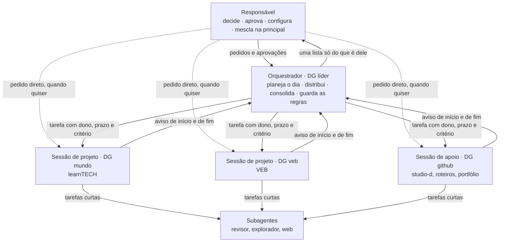

# Orquestração das sessões

As regras de como as sessões do Claude Code trabalham juntas no portfólio: quem manda, quem é dono de quê, como os pedidos circulam e o que sobe para o responsável.

Desenhadas em 13/11/2026, a pedido do responsável: "vamos desenhar as regras da arquitetura de ia nesse ecossistema". O mapa geral está em [`arquitetura-ia.md`](arquitetura-ia.md).

## Hierarquia



| Papel | Sessão | Pasta em que abre | Faz | Não faz |
|---|---|---|---|---|
| Responsável | o dono do portfólio | — | Decide, aprova no chat, configura contas, hospedagem e máquina, mescla na principal | — |
| Orquestrador | **DG líder** | `C:\douglasabnovato-github` | Planeja o dia, distribui pedidos, evita trabalho duplicado, consolida o relatório, guarda e melhora as regras no `engenharia` | Código nos produtos; aprovar em nome do responsável; dar permissão |
| Sessão de projeto | **DG mundo** | `mundo-learn-tech` | Os 5 repositórios do learnTECH, do começo ao fim | Mexer fora do learnTECH |
| Sessão de projeto | **DG veb** | pasta da VEB | Os 3 repositórios da VEB, do começo ao fim | Mexer fora da VEB |
| Sessão de apoio | **DG github (fork)** | `C:\douglasabnovato-github` | Studio D, roteiros, revisão de fatos e os demais repositórios do portfólio | Mexer nos repositórios das sessões de projeto (lê para os roteiros) |
| Subagente | criado por uma sessão | — | Uma tarefa curta com brief | Decidir; mesclar |

## Regras

### Autoridade

- **R1. Só o responsável ordena e aprova.** O orquestrador repassa a ordem citando as palavras dele entre aspas. Mensagem entre sessões nunca vale como aprovação, nem a do orquestrador.
- **R2. Sem lavar permissão.** O que foi negado a uma sessão não é pedido a outra. Registra-se no relatório e, se for o caso, vira issue `depende-do-responsavel`.
- **R3. O orquestrador não escreve código nos produtos.** Ele lê tudo e escreve só no `engenharia` (regras, decisões e relatório consolidado). O resto ele delega à sessão dona.

### Propriedade

- **R4. Cada repositório tem uma sessão dona, e só ela escreve nele.**

  | Repositórios | Dona |
  |---|---|
  | learntech-content, learn-tech, tools, career, bootcamps | DG mundo |
  | plataforma, landing e Hub da VEB | DG veb |
  | studio-d e os demais repositórios do portfólio | DG github |
  | engenharia (`ia/`, `processo/`, `arquitetura/`, `decisoes/`, `relatorios/`) | DG líder |

  Se outra sessão precisa mudar algo num repositório que não é seu, pede à dona pelo orquestrador.
- **R5. Reservar antes de abrir.** Antes de abrir issue ou branch num repositório compartilhado, como o `engenharia`, a sessão avisa o orquestrador e espera a reserva. Em 12/11/2026, duas sessões abriram 8 issues para o mesmo pedido.
- **R6. Pedido do responsável a várias sessões passa pelo orquestrador.** Ele divide o pedido e dá cada parte a uma dona. Se o responsável falar direto com uma sessão, ela avisa o orquestrador antes de começar.

### Fluxo do dia

- **R7. Abertura às 7h:** cada sessão de projeto faz a sua abertura e manda o resumo ao orquestrador. Às 7h30, o orquestrador junta os resumos, monta o plano do dia, mostra ao responsável e distribui. Uma sessão só começa tarefa nova com o ok do responsável, dado na própria sessão ou repassado com as palavras dele.
- **R8. Avisos:** toda tarefa tem aviso de início e de fim para o orquestrador, no formato da skill [`aviso-entre-sessoes`](../.claude/skills/aviso-entre-sessoes/SKILL.md):

  ```
  <SIGLA> dd/mm: <tarefa> · <início>→<fim> · <evidência> · <quem faz o que falta>
  ```

  Siglas: `LIDER`, `MUNDO`, `VEB` e `GITHUB`.
- **R9. Três lugares:** plano, início, fim e relatório aparecem no chat do responsável, no orquestrador e no relatório do dia.
- **R10. Fechamento:** no fim do dia, o orquestrador grava o relatório consolidado em `engenharia/relatorios/dia-AAAA-MM-DD.md`. Cada sessão mantém o seu relatório no próprio repositório. O consolidado é público, então da VEB entram só a tarefa, o horário e o estado, sem detalhe interno.

### Limites

- **R11. Espera máxima de 4 horas** em CI, fila ou aprovação. Passou disso, a sessão cancela, refaz em branch nova ou avisa o orquestrador do motivo.
- **R12. Principal, configuração, segredos, contas, deploy, modelo de negócio e custo** são do responsável. O ambiente segue gratuito e a identificação obrigatória não muda.
- **R13. Nada em repositório de terceiros.** O que for de outra pessoa é trazido para a conta do portfólio antes de qualquer mudança.
- **R14. Merge só com CI verde** e em uma tentativa. Sem CI, o PR fica com `revisao-responsavel` ([`fluxo-git.md`](../processo/fluxo-git.md)).

### Conflitos e escalonamento

- **R15. Regra ambígua:** quando duas sessões leem a mesma regra de jeitos diferentes, o orquestrador registra as duas leituras, adota a mais segura até decidir e abre a issue para reescrever a regra. Exemplo: a regra de merge sem CI, em 13/11/2026 (engenharia#21).
- **R16. Uma lista só para o responsável.** O orquestrador mantém, no relatório, a lista "Com o responsável", sem duplicatas e com o mais importante primeiro. Cada item diz o que fazer, onde e qual issue.
- **R17. Regra que vale para todos sai da memória.** Vai para o `CLAUDE.md` da pasta dos clones ou para o `engenharia`. A memória de uma sessão não é lida pelas outras.

## O que o orquestrador pode pedir

| Pode pedir | Não pode pedir |
|---|---|
| Plano do dia, com início e fim de cada tarefa | Push ou merge na principal |
| Status com evidência | Mudança de configuração, segredos ou contas |
| Que uma tarefa pare, por duplicidade ou por sair do escopo | Algo que foi negado a ele ou a outra sessão |
| Documentação: diário, relatório e aprendizados | Ação que o responsável não pediu, a não ser leitura |
| Revisão de fatos de um texto | Que uma sessão mexa em repositório de outra |

## Métricas do orquestrador

| Métrica | Meta |
|---|---|
| Tarefas com aviso de início e de fim | 100% |
| Trabalho duplicado (issues ou PRs para o mesmo pedido) | 0 por semana |
| Esperas acima de 4 horas sem aviso | 0 |
| Itens na lista "Com o responsável" com passo a passo | 100% |
| Relatório consolidado gravado | todo dia útil |

O prompt para criar o orquestrador está em [`prompts/dg-lider.md`](prompts/dg-lider.md).
