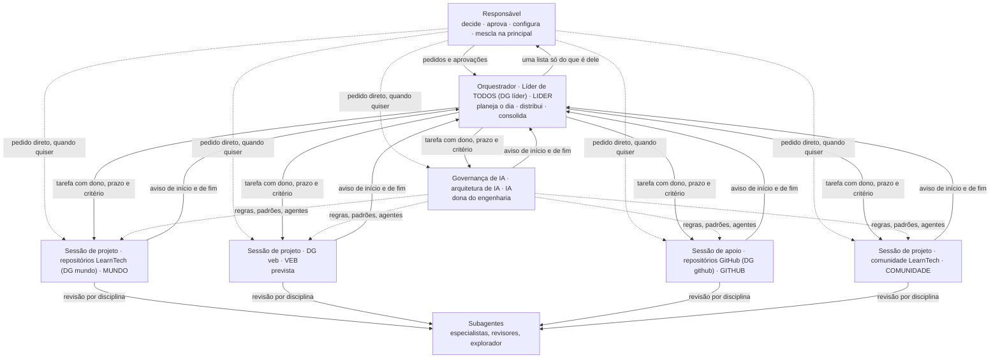

# Orquestração das sessões

As regras de como as sessões do Claude Code trabalham juntas no portfólio: quem manda, quem é dono de quê, como os pedidos circulam e o que sobe para o responsável.

Desenhadas em 13/11/2026, a pedido do responsável: "vamos desenhar as regras da arquitetura de ia nesse ecossistema". O mapa geral está em [`arquitetura-ia.md`](arquitetura-ia.md).

## Hierarquia



Nomes atualizados em 20/11/2026 pelo responsável: "dg lider é o lider de todos / dg mundo é o learntech / dg veb, ainda nao inseri para a gente trabalhar mas em breve voce tera esse contexto / engenharia é a arquitetura de ia".

| Papel | Sessão | Pasta em que abre | Faz | Não faz |
|---|---|---|---|---|
| Responsável | o dono do portfólio | — | Decide, aprova no chat, configura contas, hospedagem e máquina, mescla na principal | — |
| Orquestrador | **Líder de TODOS** (antes "DG líder") · `LIDER` | `C:\douglasabnovato-community` | Líder maior: orquestra os **fluxos** (plano do dia, distribuição, duplicidade, relatório) e os **conteúdos** (plano de conteúdo da API, do Studio D e do acervo, entregue às sessões donas). Escreve no `engenharia` só relatórios e decisões, por PR | Código nos produtos; issues e Project dos produtos; aprovar em nome do responsável; dar permissão |
| Governança de IA | **arquitetura de IA** · `IA` | `C:\douglasabnovato-ia` | Dona do `engenharia`: regras, processo, padrões por disciplina, agentes, skills, hooks e scripts. Analisa os ambientes e sugere em `orientacoes-ia.md` | Escrever em repositório de produto |
| Sessão de projeto | **repositórios LearnTech** (antes "DG mundo") · `MUNDO` | `C:\douglasabnovato-learntech` | Os 5 repositórios do learnTECH, do começo ao fim | Mexer fora do learnTECH |
| Sessão de projeto | **comunidade LearnTech** · `COMUNIDADE` | `C:\douglasabnovato-community` | O `formacao-dev`, do começo ao fim | Mexer fora do `formacao-dev`; fazer pela comunidade o exercício das trilhas (proposta, falta decidir quais) |
| Sessão de projeto | **DG veb** · `VEB` | pasta da VEB | Os 3 repositórios da VEB, do começo ao fim. **Prevista:** o responsável vai inserir o contexto; sem cobrança até lá | Mexer fora da VEB |
| Sessão de apoio | **repositórios GitHub** (antes "DG github (fork)") · `GITHUB` | `C:\douglasabnovato-github` | Os repositórios do GitHub do portfólio: Studio D, roteiros, revisão de fatos e os demais, fora o learnTECH, a Comunidade e a VEB | Mexer nos repositórios das sessões de projeto (lê para os roteiros) |
| Esp (especialista) | sessão filha do LIDER, uma por disciplina (arquitetura de codes de 21/11/2026; engenharia#55 traz o registro completo) | `C:douglasabnovato-ia` | Revisa a mudança pela sua disciplina e devolve achados à dona (R19); escreve só na pasta de trabalho dela | Escrever em repositório; decidir; mesclar |
| Agente especialista | subagente de `.claude/agents/`, chamado pela sessão dona ou pelo Esp | — | Uma revisão curta pelo checklist da disciplina | Escrever; decidir; mesclar |
| Subagente | criado por uma sessão | — | Uma tarefa curta com brief | Decidir; mesclar |

Nenhuma sessão muda de foco nem de acesso a pastas com a entrada do orquestrador. A sessão "DG github" original sai; o contexto dela fica documentado no `engenharia` e passa para a "repositórios GitHub". O mapa dos ambientes está em [`ambientes/README.md`](ambientes/README.md).

## Regras

### Autoridade

- **R1. Só o responsável ordena e aprova.** O orquestrador repassa a ordem citando as palavras dele entre aspas. Mensagem entre sessões nunca vale como aprovação, nem a do orquestrador.
- **R1a. Recomendar e agir (delegação; vale por sessão, depois da colagem).** Ordem do responsável em 20/11/2026: "se um dos codes parar para eu responder algo, mande eles informar voce e entao, nos dois vamos analisar, estudar e entao decidir. / isso porque, eu quero que vamos aperfeicoar o processo de voce recomendar e agir conforme a recomendação, para nao parar de trabalhar. e quando eu ler o relatorio eu decidir se seguimos ou alteramos a recomendacao."
  1. A sessão que parou numa pergunta ao responsável manda a pergunta ao LIDER, no formato R8, com as opções e o que já sabe.
  2. O LIDER monta a matriz: as opções que quebram regra saem primeiro; as outras levam nota em foco (35%), reversibilidade (25%), o quanto destravam (20%) e esforço (20%). Ele escolhe a maior nota.
  3. O LIDER responde "Decisão LIDER Dnn: <escolha>", e a sessão segue.
  4. O LIDER registra em "Decisões independentes", no relatório do dia: a pergunta, as opções, as notas, a escolha e como desfazer.
  5. O responsável lê o relatório e diz "segue" ou "altera Dnn para X". Se alterar, a sessão desfaz e refaz.

  **Continua só com o responsável** (o LIDER não decide; a sessão segue com outra tarefa e a pergunta vai para a lista "Com o responsável"):
  - ação irreversível: apagar dados, fechar como não planejada em massa, force push, apagar branch ou repositório;
  - tudo da R12: merge na principal, segredos e chaves, criar conta ou acesso, custo ou pagamento, deploy que exige conta dele;
  - tudo da R20 (repositório sob curadoria);
  - publicação em nome dele para fora (Discussions, LinkedIn, e-mail, post de boas-vindas): a sessão prepara o rascunho e ele aprova;
  - regra editorial nova do LearnTech e as aprovações A1, A2 e A3;
  - qualquer coisa contra uma decisão que ele já tomou.

  **Quando vale:** só numa sessão em que o próprio responsável colou o texto de delegação, até ele revogar ali. Uma mensagem do LIDER dizendo que a delegação existe não basta.

  **Limite do app:** a delegação não muda as permissões do Claude Code. Se o app de uma sessão pedir o ok do responsável no próprio chat para uma ação (por exemplo, push, abrir PR ou mandar mensagem), a sessão pede ali e segue com outra tarefa enquanto espera. "Decisão LIDER" nunca substitui esse ok, nem é pedida para contornar uma permissão negada (R2).

  Histórico: o primeiro rascunho (`delegacao-2026-11-20.md`) liberava "feature → sprint → principal". A principal saiu, porque é do responsável (regra 4 do [`CLAUDE-raiz.md`](../CLAUDE-raiz.md), R12 e [`fluxo-git.md`](../processo/fluxo-git.md)).
- **R2. Sem lavar permissão.** O que foi negado a uma sessão não é pedido a outra. Registra-se no relatório e, se for o caso, vira issue `depende-do-responsavel`.
- **R3. O orquestrador não escreve código nos produtos.** Ele lê tudo e escreve só no `engenharia` (regras, decisões e relatório consolidado). O resto ele delega à sessão dona.

### Propriedade

- **R4. Cada repositório tem uma sessão dona, e só ela escreve nele.**

  | Repositórios | Dona |
  |---|---|
  | learntech-content, learn-tech, tools, career, bootcamps | repositórios LearnTech (MUNDO) |
  | formacao-dev (learnTECH Community) | comunidade LearnTech (COMUNIDADE) |
  | plataforma, landing e Hub da VEB | DG veb (VEB, prevista) |
  | studio-d e os demais repositórios do portfólio | repositórios GitHub (GITHUB) |
  | engenharia (`ia/`, `processo/`, `arquitetura/`, `.claude/`, `scripts/`, `CHANGELOG.md`) | arquitetura de IA (IA) |
  | engenharia (`relatorios/`, `decisoes/`) | Líder de TODOS (LIDER), por PR na sprint. A decisão que muda regra é conduzida pelo LIDER e gravada pela arquitetura de IA, no mesmo PR da regra (exemplo: decisão 138, engenharia#59) |

  Os itens de cada repositório no Project 2 são da sessão dona daquele repositório. O orquestrador só lê o Project.

  Se outra sessão precisa mudar algo num repositório que não é seu, pede à dona pelo orquestrador.
- **R5. Reservar antes de abrir.** Antes de abrir issue ou branch num repositório compartilhado, como o `engenharia`, a sessão avisa o orquestrador e espera a reserva. Em 12/11/2026, duas sessões abriram 8 issues para o mesmo pedido.
- **R6. Pedido do responsável a várias sessões passa pelo orquestrador.** Ele divide o pedido e dá cada parte a uma dona. Se o responsável falar direto com uma sessão, ela avisa o orquestrador antes de começar.

### Fluxo do dia

- **R7. Dia em cinco tempos** (fluxo aprovado pelo responsável em 15/11/2026: "aprovo o fluxo"):

  | Hora | Tarefa agendada | Quem | Faz |
  |---|---|---|---|
  | 6h30 | `abertura-do-dia-learntech`, `abertura-do-dia-veb`, `revisao-d1-github` | uma sessão nova por projeto | Revisão D-1: separa o que o responsável fez do que o Claude fez (commits com e sem `Co-Authored-By`, PRs, conversas do Remote Control), propõe de 3 a 5 entregas e avisa o orquestrador. **Não começa entrega** |
  | 6h50 | `abertura-do-dia-lider` | orquestrador | Confere se as revisões rodaram ou travaram, monta o plano do dia e o pacote de merge (PRs com CI verde, em ordem) e mostra ao responsável |
  | depois do ok | — | orquestrador e sessões | O orquestrador repassa a cada sessão só a sua parte, com as palavras do responsável. As sessões executam só nos próprios repositórios, com aviso de início e de fim |
  | 12h30 | `checkpoint-lider` | orquestrador | Atualiza o quadro, cobra o limite de 4 horas e aponta duplicidade |
  | 18h30 | `fechamento-lider` | orquestrador | Grava o relatório consolidado (R10) |
  | sexta, 17h | `semana-lider` | orquestrador | Métricas da semana, aprendizados, plano de conteúdo e sessões a recomeçar por contexto longo |

  Uma sessão só começa tarefa nova com o ok do responsável, dado na própria sessão ou repassado com as palavras dele. A revisão roda em sessão nova, só leitura, para não travar em permissão nem encher o contexto das sessões principais. Antes de distribuir uma tarefa de conteúdo, o orquestrador lista o que já existe no repositório de destino.
- **R7a. Limite de trabalho em aberto:** projeto com mais de 5 PRs esperando o responsável não recebe construção nova no plano do dia, só correção e documentação.
- **R8. Avisos:** toda tarefa tem aviso de início e de fim para o orquestrador, no formato da skill [`aviso-entre-sessoes`](../.claude/skills/aviso-entre-sessoes/SKILL.md):

  ```
  <SIGLA> dd/mm: <tarefa> · <início>→<fim> · <evidência> · <quem faz o que falta>
  ```

  Siglas: `LIDER`, `IA`, `MUNDO`, `COMUNIDADE`, `GITHUB` e `VEB` (prevista).
- **R9. Três lugares:** plano, início, fim e relatório aparecem no chat do responsável, no orquestrador e no relatório do dia.
- **R10. Fechamento:** às 18h30, o orquestrador grava o relatório consolidado em `engenharia/relatorios/dia-AAAA-MM-DD.md`. Cada sessão mantém o seu relatório no próprio repositório. O consolidado é público, então da VEB entram só a tarefa, o horário e o estado, sem detalhe interno.

### Limites

- **R11. Espera máxima de 4 horas** em CI, fila ou aprovação. Passou disso, a sessão cancela, refaz em branch nova ou avisa o orquestrador do motivo.
- **R12. Principal, configuração, segredos, contas, deploy, modelo de negócio e custo** são do responsável. O ambiente segue gratuito e a identificação obrigatória não muda.
- **R13. Nada em repositório de terceiros.** O que for de outra pessoa é trazido para a conta do portfólio antes de qualquer mudança.
- **R14. Merge só com CI verde** e em uma tentativa. Sem CI, o PR fica com `revisao-responsavel` ([`fluxo-git.md`](../processo/fluxo-git.md)).

### Escala e qualidade (20/11/2026)

- **R18. Ação em massa só com simulação e o ok do responsável.** Mais de 10 escritas de uma vez no GitHub (issues, rótulos, campos do Project, comentários, PRs) ou qualquer escrita fora do repositório dono: primeiro roda a simulação (como o `scripts/preencher-project.py` sem `--gravar`), mostra a lista ao responsável e só grava com o ok dele. Ninguém escreve em repositório de outra sessão, nem com um pedido genérico. Motivo: o pós-incidente de 20/11/2026 ([decisão](../decisoes/2026-11-20-governanca-ia.md)).
- **R19. Revisão pelo especialista da disciplina.** O PR de um repositório N2 ou N3 cita o checklist das disciplinas que ele toca ([`disciplinas.md`](../arquitetura/disciplinas.md)) e passa pela revisão do Esp da disciplina (ou do agente especialista, quando o Esp chamar) antes do merge na sprint. O especialista só revisa; quem corrige é a sessão dona. Os portões de qualidade estão em [`ciclo-evolutivo.md`](../processo/ciclo-evolutivo.md).
- **R20. Repositório sob curadoria do responsável.** Hoje só o `douglasabnovato/douglasabnovato.dev`, o portfólio que ele apresenta em entrevistas, a clientes da startup e na captação de recursos. Ordem do responsável em 20/11/2026: "esse projeto deve ser tratado de forma diferente dos demais do contexto do repositorios github pois ele sempre será medotico e detalhadamente cuidadosamente passado por mim para ser real". Num repositório sob curadoria:
  - fica fora de ação em lote (R18), automação, workflows herdados e planos genéricos;
  - toda mudança é proposta item a item, com o texto exato e a fonte, e só entra depois que o responsável aprovar **aquela** mudança;
  - nenhum fato, número, cliente, cargo ou resultado entra sem evidência dada por ele;
  - no plano do dia, no painel e nos relatórios, não é cobrado por ritmo.

  Incluir ou tirar um repositório desta lista é decisão do responsável.

### Ativação e melhoria contínua (20/11/2026)

- **R21. Rotina de ativação e modo melhoria.** Ordem do responsável em 20/11/2026: "precisamos ter uma rotina de ativação dos codes para estarem atuando no projeto sempre / e em caso de eu nao ter dado tarefa, que cada um analise as documentacoes, analise os projetos, entenda os proprios papeis, pesquise e estude sobre arquitetura de ia, e proponha aperfeiçoamento nas nossas rotinas e processos. / os codigos so sao alterados com a minha ordem direta, mas o nosso fluxo de trabalho pode e deve ser aperfeicoado e automatizado gradativamente para EU SABER e DOMINAR oque estamos fazendo sempre".
  - **Pulso:** uma tarefa agendada do LIDER olha as sessões donas em horários fixos. A sessão rodando não recebe nada. A parada com tarefa na fila recebe "continue" e o próximo item. A parada sem tarefa entra no modo melhoria. O pulso só manda mensagem: não decide nada pelo responsável e não escreve no GitHub.
  - **Modo melhoria**, um ciclo de até 1 hora:
    1. reler o papel (`CLAUDE.md`, estas regras, o próprio `ESTADO.md` ou `MVP.md`);
    2. analisar o que travou, demorou ou se repetiu;
    3. estudar um tema de [`estudos/`](estudos/README.md) ligado ao problema;
    4. mandar **uma** proposta ao LIDER;
    5. uma vez por semana, dizer se o contexto precisa de outra sessão.
  - **Formato da proposta:**

    ```
    PROPOSTA <SIGLA> dd/mm: <título curto>
    Problema observado: <fato com evidência>
    Proposta: <o que muda no processo ou na rotina>
    Ganho esperado: <métrica do ciclo-evolutivo.md>
    Custo e risco: <esforço, tokens, o que pode dar errado>
    Automação possível: <script, skill, hook ou tarefa agendada>
    O que o responsável passa a saber ou dominar: <painel, relatório, regra>
    ```

  - **Limites:**
    - nenhum código de produto muda no modo melhoria; código só muda com ordem direta do responsável;
    - a proposta não se aplica sozinha: o LIDER registra, pontua pela matriz e leva ao relatório;
    - com o ok do responsável, regra entra aqui por PR da arquitetura de IA, e script ou tarefa entra pela dona;
    - rascunhos só na pasta de trabalho da sessão, fora dos repositórios.
  - **Transparência:** toda automação nova aparece no painel ou no relatório, com o que faz, quando roda e como desligar.
  - **Sessão nova:** a proposta diz o papel, os repositórios que passa a ter (R4), o que sai da sessão atual e a carga que justifica. Criar a sessão é do responsável. O mapa atual está em [`ambientes/mapa-de-papeis.md`](ambientes/mapa-de-papeis.md).

  As propostas alimentam o ciclo semanal de [`ciclo-evolutivo.md`](../processo/ciclo-evolutivo.md).

### Conflitos e escalonamento

- **R15. Regra ambígua:** quando duas sessões leem a mesma regra de jeitos diferentes, o orquestrador registra as duas leituras, adota a mais segura até decidir e abre a issue para reescrever a regra. Exemplo: a regra de merge sem CI, em 13/11/2026 (engenharia#21).
- **R16. Uma lista só para o responsável.** O orquestrador mantém, no relatório, a lista "Com o responsável", sem duplicatas e com o mais importante primeiro. Cada item diz o que fazer, onde e qual issue.
- **R17. Regra que vale para todos sai da memória.** Vai para o `CLAUDE.md` da pasta dos clones ou para o `engenharia`. A memória de uma sessão não é lida pelas outras.

## O que o orquestrador pode pedir

| Pode pedir | Não pode pedir |
|---|---|
| Plano do dia, com início e fim de cada tarefa | Push ou merge na principal |
| Status com evidência | Mudança de configuração, segredos ou contas |
| Que uma tarefa pare, por duplicidade ou por sair do escopo | Algo que foi negado a ele ou a outra sessão |
| Documentação: diário, relatório e aprendizados | Ação que o responsável não pediu, a não ser leitura |
| Revisão de fatos de um texto | Que uma sessão mexa em repositório de outra |

## Métricas do orquestrador

| Métrica | Meta |
|---|---|
| Tarefas com aviso de início e de fim | 100% |
| Trabalho duplicado (issues ou PRs para o mesmo pedido) | 0 por semana |
| Esperas acima de 4 horas sem aviso | 0 |
| Itens na lista "Com o responsável" com passo a passo | 100% |
| Relatório consolidado gravado | todo dia útil |

O prompt para criar o orquestrador está em [`prompts/dg-lider.md`](prompts/dg-lider.md).
